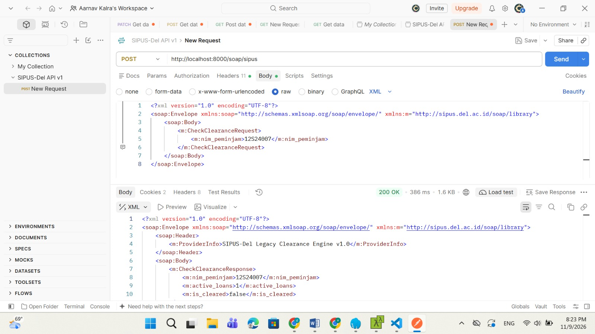
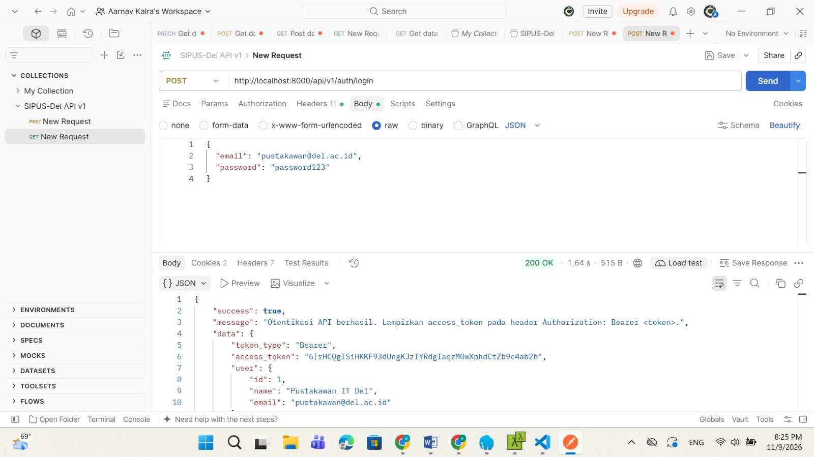
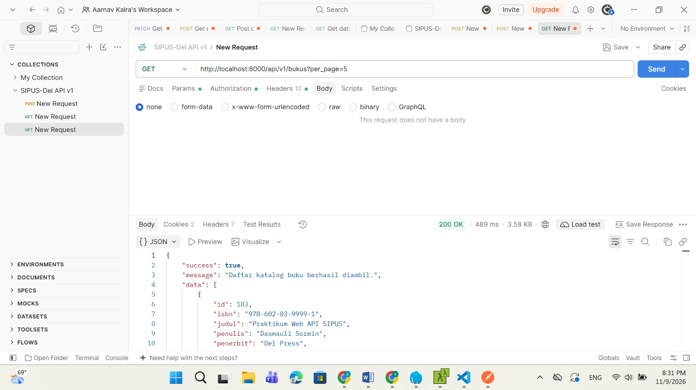
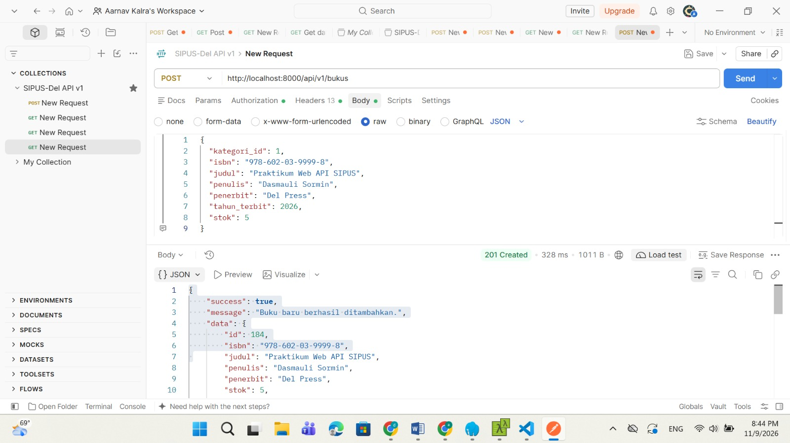
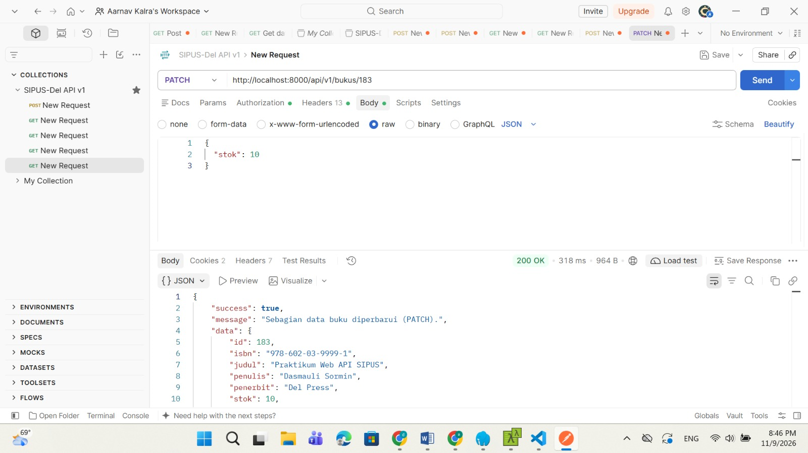
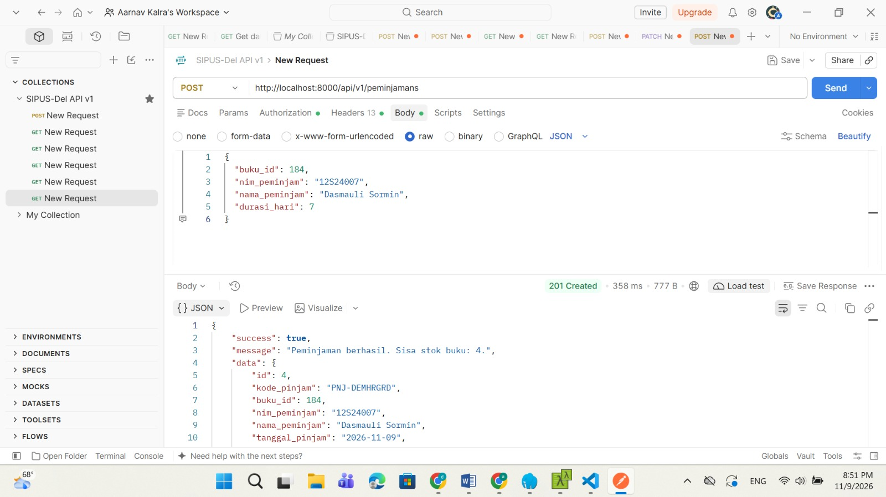
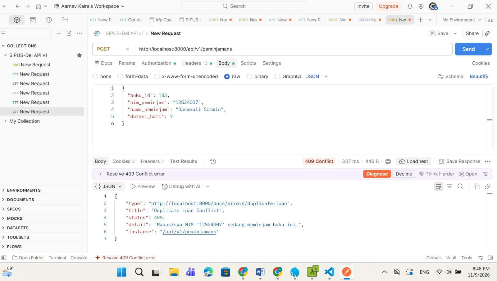
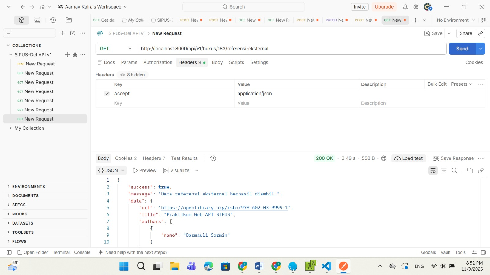

# SIPUS-Del - Sistem Informasi Perpustakaan IT Del

Aplikasi pengelolaan perpustakaan berbasis Laravel 11 untuk tugas praktikum Minggu 6 PPW.

## Kredensial Uji Pustakawan
* **Email**: `pustakawan@del.ac.id`
* **Password**: `password123`

## Cara Menjalankan Aplikasi
1. Clone repository
2. Jalankan `composer install`
3. Salin `.env.example` ke `.env` dan atur koneksi database (`sipus-del`)
4. Jalankan migrasi dan seeder:
   ```bash
   php artisan migrate:fresh --seed

   ### 1. Pengujian SOAP Service (Check Stok)


### 2. Autentikasi Sanctum (Login)


### 3. Katalog Buku Terpaginasi & Filter


### 4. Tambah Buku Baru (POST 201 Created)


### 5. Update Stok Buku (PATCH 200 OK)


### 6. Transaksi Peminjaman Buku (ACID Transaction)
* **Peminjaman Sukses (201 Created):**
  
* **Penolakan Stok Habis / Duplicate Loan (422 / 409):**
  

### 7. Integrasi Referensi Eksternal (OpenLibrary)
